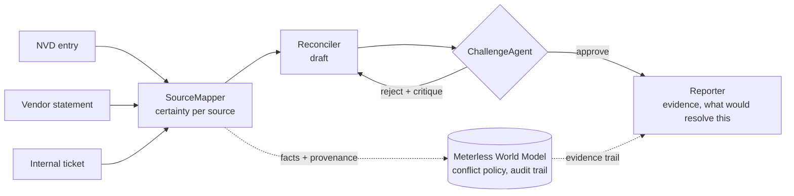

# Vulnerability Conflict Resolver

**Track:** The Agent That Can Explain Why
**Problem:** helps a security analyst decide how urgently to patch a
reported vulnerability by reconciling conflicting signals from a public
vulnerability database, a vendor changelog, and internal ticket notes -
producing an assessment with a confidence level and the full evidence
path, including anything it could not resolve.

**Reviewing this?** [`JUROR_QUICKSTART.md`](JUROR_QUICKSTART.md) checks the project in 5 minutes with three commands and the expected output; [`FAQ.md`](FAQ.md) answers the hard questions (simulated data, own corpus, what Meterless really does, what is missing).

## In 60 seconds

**The problem.** A vendor says "fixed", the database says "critical", and your own ticket says two of four clusters are unconfirmed. Equifax (2017) lost data on about
147 million people although the Struts fix had been public for months. Deciding what is *really* resolved is the hard part.

**What it does.** Four agents (SourceMapper, Reconciler, ChallengeAgent, Reporter) read the three sources for a CVE. The Challenge Agent checks the first draft against the evidence and
can reject it. Nothing counts as resolved until the internal evidence says so, and for the fix path that means a named verification, a version and a scope.
Each report ends with the evidence trail and **what would resolve the case**; a triage list ranks all cases; a timeline shows how the answer changes as evidence arrives.

**Try it** (no AI model, nothing to install): `python3 main.py` - or your own CVE: `python3 main.py --cve CVE-2021-44228 --vendor input_examples/byo_vendor.txt --internal input_examples/byo_internal.txt`.

| | |
|---|---|
| **Data** | 14 sample cases (public NVD facts, paraphrased vendor text, **synthetic** internal tickets) and 3 cases with **real** advisory text (`data/real_world/`, synthetic tickets) |
| **Sponsor tech** | **Meterless** World Model: the unmodified reference engine runs through a Node bridge (Python fallback). **Zetaris**: data layer, read with SQL (live-verified, see the Zetaris section). **NVIDIA**: Nemotron 3.5 lightning run live and measured on the corpus (directly via NVIDIA's API, not through Nightshift). **Cursor**: see `metadata.json` |
| **Tests** | 10 `check_*.py` scripts, all offline, run in CI (`.github/workflows/checks.yml`) |
| **Measured** | 286-sentence corpus (dev/test split): rules alone miss most hedges, the language model flags many clear statements; six prompt versions documented, none better than the default under a rule fixed in advance. On 24 real advisory sentences the model flagged 13 of 17 clear ones |
| **Not done** | Findings per asset from scanners, KEV/EPSS, CSAF/VEX, real internal tickets, real users. Rule-based checks on free text stay brittle against new wording |

The rest of this file is the long form: design decisions, failures we found and what we changed, and the measurements.

## Quick start — two modes

```bash
python3 main.py # no AI model, nothing to install
```

There is also a version **with an AI model** (Ollama, free and local) that reads each source and
writes the reports in prose. **`SETUP.md` lists exactly what to download for each mode** and says
honestly what the AI adds - and what it does not.

Ready-made output without running anything: `output_examples/`. Pitch deck and form text: `submission/`.

## Architecture at a glance



## What this is, and what it is not

A decision-support **prototype** built for a hackathon track ("explain why"), not a tool for production use. Its checks are rules on free text (plus an optional language model),
and our own reviews show that such checks stay brittle against new wording (see the next section). It aims to be honest about that, not to be complete.

## A false "resolved" found by an outside review (fixed)

## Real-world cases (real advisories, synthetic tickets)

`data/real_world/cases.json` holds three real CVEs (PAN-OS CVE-2024-3400, OpenSSH CVE-2024-6387, xz CVE-2024-3094). CVSS and severity are
read from the NVD; the NVD description is the opening sentence plus a short summary (not full verbatim text). The vendor text is **verbatim fragments** of the
real advisory (URL in each source's `note`). The internal tickets are **synthetic**; nobody publishes real ones. Run:
`python3 main.py --with-real` (all 17 cases in one ranking, viewer included), `python3 main.py --data data/real_world/cases.json` or `python3 check_real_world.py`.

Result: 2 of 3 come out as intended. The OpenSSH case shows a **known gap**: the release notes say "This release contains fixes for two security problems",
and our fix-claim rule does not know that wording, so the system stays on "unresolved" (the safe direction) although the ticket confirms the upgrade.
We did not patch the rule for this one case; widening it would need a re-run of the corpus and the 14 sample cases first.

## Bring your own CVE

```bash
python3 main.py --cve CVE-2021-44228 --vendor input_examples/byo_vendor.txt --internal input_examples/byo_internal.txt
```

Fetches the NVD entry live (NVD API 2.0; set `NVD_API_KEY` to avoid rate limits), takes the vendor and ticket texts from your files and runs the
same pipeline. Missing files count as unconfirmed sources, never as safe. Offline: `--nvd-file data/fixtures/nvd_sample_response.json`.
**Honest status:** the parser is tested offline against a hand-written fixture in the documented NVD 2.0 shape (`check_byo_cve.py`). The live call
(`python3 check_byo_cve.py --live`) passed once on 24 October 2026 on the author's machine for CVE-2021-44228; it needs internet access and can hit NVD rate limits.

## Why this is an agent system, not a pipeline

```
SourceMapper -> Reconciler -> ChallengeAgent -+-> back to Reconciler (rejected, with a specific critique)
 +-> Reporter (approved)
```

The Reconciler's first pass is deliberately optimistic: it resolves using
only the vendor changelog, because that source is usually the easiest to
read as reassuring. The Challenge Agent checks that resolution against
the *internal* ticket - the only source that actually describes this
specific environment - and rejects it if the internal evidence is
missing, incomplete, or unconfirmed. On real runs this sometimes approves
immediately (internal evidence independently agrees) and sometimes forces
a real second pass (see `CVE-2021-44228` and `CVE-2024-8888` in the
sample data). Nothing here is a scripted "always retry once for show" -
run `python3 main.py` and read `logs/*.jsonl` to see it happen.

The Reconciler and Challenge Agent make every decision using fixed,
inspectable rules - never an LLM guess. The LLM (optional) only writes
the final wording in `reporter.py`. This is intentional for a track about
explainable conclusions: the decision is auditable even if the sentence
around it changes.

## A naive single-shot baseline, and what it actually taught us

`baseline_naive.py` answers the same test cases (nine at first, twelve now) with ONE unchecked LLM call -
all three sources in one prompt, a direct yes/no, no agents, no revision,
no safety nets. Run it yourself:

```bash
python3 baseline_naive.py
```

With a real local model (Ollama, `llama3:latest`), this naive approach
scored **8/9 (89%)** on the first nine test cases, consistently, across repeated runs (the set has since grown to twelve - the three newest cases deliberately have missing sources, and `baseline_naive.py` handles those too; re-run it for the current number) - a single
capable model with full context in one prompt is already quite strong.
We did not expect that, and we're not going to pretend otherwise.

The one case it got "wrong" (`CVE-2023-0005`) turned out to reveal the
naive approach was actually **more correct than our own system** - our
own keyword-based safety check in `reconciler.py` was too narrow and had
been wrongly forcing this case to "unresolved" even though the evidence
(all 6 instances, all 40 known bypass payloads, zero passed) clearly
supports "resolved". We fixed our keyword list once this was exposed,
and corrected `expected_outcome` in the test data to match - the fix and
the honest correction are both in the commit history, not hidden.

Separately, the naive approach correctly caught `CVE-2023-0004` (the
scope-overclaim trap - "fully addresses" next to "internet-facing load
balancers") on every run, something our own `SourceMapper` had missed in
isolation earlier in development. Seeing all three sources side by side
in one prompt made the contradiction obvious to the model in a way that
judging each source separately did not.

**So the honest claim this project makes is not "more accurate than a
single LLM call."** With a decent model and full context, a single call
is already strong, and a multi-agent system doesn't automatically beat
that - this project's own baseline test proved it. The real difference
is that a single-shot answer gives you a conclusion with no way to check
*why* it's right or wrong. This project's answer always comes with an
inspectable trail (`logs/*.jsonl`, the world model graph) - when it *is*
wrong, as it was here, you can find out exactly why and fix it, as this
section documents happening for real. That's the actual value for a
track about explainable conclusions: not raw accuracy, verifiability.

## Three real-world combinations of a missing source, tested directly

Beyond one isolated missing source, three named cases cover the actual
patterns that come up in practice:

- `CVE-2024-7001` - vendor fix is strong and unconditional, but nobody
 internally has checked yet. Correctly stays unresolved.
- `CVE-2024-7002` - the opposite: the vendor never responds (an
 unmaintained project), but the internal team independently verified a
 complete network-level mitigation (firewall rule, confirmed by an
 external port scan). **This one exposes a real, honest limit**: this
 system can never reach "resolved" without *some* vendor acknowledgment
 at all - `reconciler.py`'s first pass only ever checks the vendor text,
 so a vendor source that's entirely absent means the optimistic pass
 never proposes "resolved" in the first place, no matter how thorough
 the internal evidence is. We consider this the right default (always
 err toward keeping a human in the loop when a vendor has said nothing
 at all) but it is a real architectural choice, not an oversight, and
 it is worth knowing about if a vendor is ever unreachable in practice.
- `CVE-2024-7003` - day one of a disclosure: neither the vendor nor the
 internal team has had time to react, only the raw public listing
 exists. Correctly stays unresolved - there is nothing yet to resolve it.

## What happens when parts of the three sources are missing

Every combination is tested (`check_missing_sources.py`, 20 variants, no crash allowed).
A missing source becomes a placeholder with `certainty: low` ("absence of evidence is not evidence of
safety"). Starting from a case whose evidence is otherwise strong:

| NVD | Vendor | Internal | Result | Why |
|---|---|---|---|---|
| yes | yes | yes | **resolved** | all three present and consistent |
| yes | yes | no | unresolved | the vendor's claim is never confirmed for our own environment |
| yes | no | yes | unresolved | resolution starts from the vendor's claim; without one it never starts (see `CVE-2024-7002`) |
| yes | no | no | unresolved | nothing to resolve it with |
| no | yes | yes | **resolved** | the NVD only supplies the *baseline severity*; the report then says `UNKNOWN` |
| no | yes | no | unresolved | no internal confirmation |
| no | no | yes | unresolved | no vendor claim |
| no | no | no | unresolved | no evidence at all |

The row without an NVD entry is a design choice, not an accident: vendor and internal evidence together still
settle our own exposure, and the report states plainly that no baseline severity exists. If you prefer "no
NVD entry means unresolved", that is a one-line change in `reconciler.py`.

**A source that is present but incomplete used to crash the program** (11 of 12 test variants: empty text,
a missing field, a number instead of text, an NVD entry without a score - NVD entries "awaiting analysis"
really have none). Now a source without usable text counts as missing, and an NVD entry without a score
reports its severity as `UNKNOWN`. Found by asking "what if parts are missing?" - fixed, and pinned down
by the test above (it fails if the new input checks are removed).

If the *same* source keeps being absent over many cases, `agents/process_health.py` adds a separate
process warning (see below) - that is a gap in the organisation's process, not in one case.

## Noticing a broken process, not just a missing fact

A deeper question than "what if one source is missing": what if the
*same* source keeps being missing, case after case? One absent internal
ticket is a gap in the data. The internal ticket being absent for most
of the last 20 cases this tool has processed is a gap in the
organization's *process* - nobody there reliably checks their own
environment at all. That's a different, more serious problem, and it
deserves a different, clearly separate message instead of silently
repeating "unresolved" every single time with no larger context.

`agents/process_health.py` tracks source availability across runs (not
within one case) in `logs/source_availability_history.json`, and
`main.py` appends a clearly separated "PROCESS HEALTH" section to a
report once a source has been absent in at least 3 of the last 20 cases
and at a rate of 50% or higher. Tested directly: three consecutive cases
missing the internal ticket correctly trigger the warning; nine
complete real cases correctly trigger nothing; ten subsequent complete
cases correctly let the warning fade again, because the rolling window
reflects recent behaviour, not a permanent black mark.

## Why two checks, not just the LLM (a real failure we found and fixed)

During testing, a small local model (Ollama, `llama3:latest`) judged the
Log4Shell internal ticket as "high certainty" even though the text
explicitly names two of four clusters as unconfirmed - producing a
`resolved=True` report that then contradicted itself in its own evidence
section. This is exactly the kind of unsafe overclaiming a security tool
must not do.

The fix: `source_mapper.py` now runs the keyword check *and* the LLM
check, always. The LLM may downgrade a case to "low" that the keyword
list would have missed, but it can never upgrade a case to "high" if the
keyword check already found an explicit hedge. Confirmed by
`check_expected_outcomes.py`, which re-runs every sample case and
compares the actual outcome to the `expected_outcome` documented in
`data/sample/cases.json` - run it before any demo or recording:

```bash
python3 check_expected_outcomes.py
```

## A limit we found - and how far a rule can go before it needs a third check

A later test built two deliberately tricky cases with no obvious hedge
word at all: `CVE-2023-0004`, where a vendor note says "this fully
addresses the vulnerability" but the sentence right next to it only
describes patching internet-facing load balancers, quietly leaving
internal service-mesh traffic uncovered. A real local model (Ollama,
`llama3:latest`) read "fully addresses" and called it HIGH certainty,
missing the scope gap - the same kind of overclaim a rushed human reader
could miss too.

The keyword list didn't catch it either (no "unconfirmed" anywhere). So
`source_mapper.py` now runs a **third**, independent check
(`_scope_overclaim_check`): it looks for an absolute word ("fully",
"completely", "entirely") appearing together with an explicitly named
narrower subset ("internet-facing", "load balancer", ...) in the same
text. It only fires when both are present, specifically so it does not
false-positive on genuinely complete fixes like "completely removed from
the codebase" (no named subset there) - confirmed by test before this
check was added to the real pipeline.

All three checks - keywords, LLM, scope-overclaim - combine on the same
principle: whichever one is most cautious wins. No single check is
trusted alone. This is also why `check_expected_outcomes.py` now covers
12 cases (it started with 3) - the tricky ones exist specifically to keep testing
this boundary, not just to look good once.

## Two modes: with and without an AI model

Same code, one setting (`LLM_PROVIDER`, see `.env.example`):

| | `rule_based` (default, zero setup) | `ollama` / `anthropic` / `openai` |
|---|---|---|
| Certainty of each source | keyword list + scope-overclaim check | an LLM judges it as well; the **most cautious** of all checks wins |
| Final report text | fixed template | written by the LLM, then checked for contradictions (falls back to the template) |
| Decisions (resolved / unresolved, reject / revise) | deterministic rules | the **same** deterministic rules |
| Needs | nothing | a model (Ollama is free and local) |

**Which one should I use?** Neither is better overall - they fail in opposite directions; the guide with
measured numbers is in `SETUP.md` ("Which mode should I use?"). Switch per run: `python3 main.py --provider ollama`.

`rule_based` contains no AI model at all - it exists so that anyone can run the
project without keys or a GPU. In the other modes the AI never makes the final
decision: it can only make a judgement *more* cautious and write the explanation.
That split is deliberate - every decision stays traceable in `logs/*.jsonl`.

To see the AI mode in the demo video, load your `.env` first, then:
`VIDEO_TRACE_PROVIDER=ollama python3 video/make_video.py`.

## Running in Docker

Files written by the container are owned by root. The program replaces such files itself (or prints a
warning and carries on), so running plain `python3 main.py` after Docker no longer fails with a
`PermissionError`.

```bash
docker compose build
docker compose run vuln-agent # sample mode, no setup needed
docker compose run vuln-agent python3 check_expected_outcomes.py
docker compose run vuln-agent python3 main.py --case CVE-2021-44228
```

Sample mode (`LLM_PROVIDER=rule_based`, the default if `.env` is missing
or unset) needs nothing beyond the container itself - no network, no key.

If `.env` sets `LLM_PROVIDER=ollama`, the container reaches a locally
running Ollama service on the host through `network_mode: host` in
`docker-compose.yml` - this is native-Linux behaviour (tested on Kali).
On Docker Desktop (Mac/Windows) this does not work the same way; set
`OLLAMA_HOST=http://host.docker.internal:11434` in `.env` instead and
drop `network_mode: host` from the compose file. This distinction matters
because inside a container "localhost" means the container itself, not
the host machine - a real, well-known trap the project's own mentor
guidance calls out explicitly.

`anthropic`/`openai` modes need no special networking, just the API key
in `.env` - they reach the internet directly like any outbound call.

## Sponsor technology: Meterless (World Model)

[Meterless](https://github.com/Meterless/Meterless) (Apache-2.0) provides a World Model engine: entities,
relationships and *facts with provenance*, an event log, an audit trail and - the part that matters here -
a **conflict policy** for contradicting facts. That is this project's core problem (the vendor says "fixed",
the internal ticket says "unconfirmed"), so the engine is used for exactly that.

**Two layers, deliberately:**

1. **The real engine** (`integrations/meterless/`): Meterless' *unmodified* TypeScript reference
 implementation, bundled into one JavaScript file (see `NOTICE.md` for the exact source commit and
 licence), driven from Python through a small JSON-lines bridge (`bridge.mjs`, `agents/meterless_bridge.py`).
 Every case sends its sources to the engine as facts with our certainty as confidence, under the policy
 `source-priority` (internal ticket > NVD > vendor): the engine picks the winner, marks the other facts
 `supersededBy`, and writes the audit trail. The viewer shows this in the "Meterless engine" panel.
 Needs **Node.js >= 18** (no `npm install`). `--meterless auto|on|off` (default `auto`).
2. **A Python implementation of the documented schema** (`agents/world_model.py`): the fallback when Node is
 not available, so the project still runs everywhere - which the hackathon rules ask for.

**Which Meterless engines, and where:** only the **World Model** engine (`integrations/meterless/`,
`agents/meterless_bridge.py`, `agents/timeline.py`). H-MEM, Markovian, Scout Intent and Swarm are *not* mounted
(`logs/meterless_manifest.json` lists, per run, which parts are live, who reads what they write, and which are dormant).

**What the engine does for this project**
- **Canonical, idempotent ingest:** every source text is an observation sent through Meterless' ingest pipeline. Re-running
 the same evidence appends **0 events** (the run record says `skippedUnchanged`), a changed text updates the world.
- **Stored and resumable:** the world is kept per *evidence state* (`logs/.world/<CVE>-<fingerprint>.json`), so an unchanged
 re-run resumes it and changed evidence starts a fresh world (a deleted ticket can never keep "winning" from an old run).
- **Evidence as JSONL:** `logs/<CVE>_meterless.jsonl` holds the run record, **every event with its source**, each belief
 (winner/superseded) and the audit trail - "why the system believed X, and the observation it came from".
- **Read by a consumer:** every report ends with an **EVIDENCE TRAIL** built from the engine's state (not just stored).

**What is verified** (`python3 check_meterless_bridge.py`): the entity IDs our Python port computes are identical to the
real engine's for all sample cases **and the engine really created those entities**; the conflict verdict is "internal
wins, vendor superseded" wherever both exist; a second run - in another process - appends 0 events and ends in the same
state; a crash mid-run (`kill -9`) resumes to the same state as a clean run, without duplicates; a half-written store file
is quarantined and rebuilt; missing sources send no evidence; without Node, with a crashing bridge, and with
`--meterless off` the pipeline runs on and says why. The key safeguards - ID parity, priority order, rebuilding the conflict state from the log, repairing a half-written store, the evidence trail - were each deliberately broken to confirm that the test then fails; not every single check was mutation-tested.

**Limits, stated plainly:** the engine's verdict follows the *priority order we configured*, so on its own it
does not discover anything our rules do not already say - its value is the explicit, auditable "why" (which
fact superseded which, under which policy, with provenance). We did not use Meterless' other engines
(`hmem`, `markovian`, `scout-intent`) or its operator control plane, and Meterless' own conformance suite is
TypeScript-only, so it cannot be run against the Python port. **Two limits of the reference we found and handled:** its local store writes its file non-atomically (a crash mid-write can corrupt it - we quarantine the file and rebuild from the evidence), and after a reload it loses the 'superseded' markers (they are set in memory, never in the log - we rebuild the conflict state from the append-only log by replaying the stored assertions through the engine's own conflict policy; the engine itself stays unmodified). Its `entityAt` time travel cannot reconstruct historical conflict winners (see Timeline).

## Sponsor technology declaration

`metadata.json` records which sponsor technologies were used and where,
as each sponsor's overview document asks for.

Scope, stated honestly: with Node.js >= 18 the **unmodified Meterless TypeScript reference World Model** runs for every
case (see the Meterless section above). Without Node, a Python port of the documented schema runs instead and each
report says so. Meterless' own conformance suite is TypeScript-only and was not run against the port. Only the World Model
engine is used; H-MEM, Markovian, Scout Intent and Swarm are not.

## Measuring the certainty judgement on many more texts

`evaluation/` holds a labelled corpus (`corpus.jsonl`, generated by `make_corpus.py`) and a harness
(`evaluate.py`): 286 short source texts, 3 kinds of clearly confirmed text and 8 kinds of hedge (explicit,
partial coverage, pending rollout, stale check, assumption, exception clause, scope overclaim, named gap),
6 wordings each. Wordings 0-2 are the **dev** half, 3-5 the **test** half; rules were only ever improved
from dev errors. The harness counts the dangerous error (a hedged text rated "certain") separately from
the harmless one (a certain text rated "hedged").

Rule-only mode (no AI), measured:

| | correct | hedges missed (dangerous) | false alarms |
|---|---|---|---|
| keyword list only, dev / test | 66.7% / 60.6% | 48/54 / 56/56 | 0/90 / 0/86 |
| all rules, **dev** (tuned on it) | 100% | 0/54 | 0/90 |
| all rules, **test** (not tuned on it) | 61.3% | **55/56** | 0/86 |
| language model alone (prompt v1), dev / test | 56.2% / 64.1% | 1/54 / 1/56 | 62/90 / **50/86** |
| rules + model, as first shipped (prompt v1), dev / test | 56.9% / 64.1% | 0/54 / **1/56** | 62/90 / 50/86 |
| language model alone (**prompt v2**, now default; two identical runs), dev / test | 75.7-78.5% / **90.8-91.5%** | 3/54 / **3/56** (both runs) | 28-32/90 / **9-10/86** |
| rules + model (**prompt v2**), dev / test | 77.8-80.6% / **90.8-91.5%** | 0/54 / **3/56** | 28-32/90 / 9-10/86 |
| language model alone (**Nemotron 3.5 lightning**, NVIDIA API, prompt v2, thinking off; two runs, 23 Oct 2026), dev / test | 88.2-90.3% / **98.6%** (both runs) | 3/54 / **2/56** (both) | 11-14/90 / **0/86** (both) |
| rules + that model, dev / test | 90.3-92.4% / **98.6%** | 0/54 / **2/56** | 11-14/90 / **0/86** |
| language model alone (prompt v3, tried, **not adopted**), dev / test | 77.8% / 83.8% | 0/54 / **1/56** | 32/90 / **22/86** |
| language model alone (prompt v4 checklist, tried, **not adopted**; two identical test runs), dev / test | 98.6% / 92.3% | 2/54 / **1/56** | 0/90 / **10/86** |
| language model alone (prompt v5 majority, tried, **not adopted**; two identical test runs), dev / test | 95.8% / 85.9% | 0/54 / **1/56** | 6/90 / **19/86** |

Honest reading:
- **The rules** fixed the dev wordings and almost nothing else - they do not generalise to new phrasing.
- **The language model is their mirror image - and prompt v2 fixed most of its weakness.** Measured with Ollama
 (`llama3:latest`) on the test half: with the first prompt (v1) it missed only 1 of 56 hedges but rated **50 of 86
 (58%)** clearly confirmed texts as uncertain. **Prompt v2** (now the default; measured twice) cut the
 false alarms to **9-10 of 86 (10.5-11.6%)** and misses **3 of 56 (5.4%)**, against 55 of 56 for the rules. Because the most
 cautious check wins, the combined mode equals the model on the test half. That fails *safe* (more cases go to a
 human) and is now much quieter. `CERTAINTY_PROMPT=v1` reproduces the old numbers. The trade-off is real: two more
 missed hedges bought about 40 fewer false alarms. **Measurement noise:** two runs of the identical prompt (temperature 0)
 differed - dev false alarms 28 vs 32 of 90, test 9 vs 10 of 86 - so differences of one or two texts mean nothing.
- **What still fails** (see `evaluation/RESULTS.md`): (1) "if / should" wording around a completed check is still
 often rated uncertain - 20 of 30 on dev, 9 of 28 on test; the model's own reasoning then invents gaps ("the
 remaining servers are unaddressed" for "every one of the 8 servers"); (2) the 3 remaining misses on the test half
 are all **scope overclaims** - a confident "fully resolves the issue" about only a named subset. The rules miss
 them on the test half too, and on dev the model takes "completely resolves" at face value. This is the hardest kind:
 nothing in the sentence admits a doubt. (3) The dev half is *worse* than the test half (28 of 90 false alarms, 31%).
 We do not know why; the test half is the fair number, but we do not claim the model is this good everywhere.
 Note the corpus texts are single sentences; all 14 sample cases (longer tickets) came out right in AI mode too.
- **Prompt v3 - tried, measured, not adopted.** It was written from the dev-half errors only (the test half was not looked at;
 its three examples are invented, and `check_prompt_versions.py` fails if one appears in the corpus). The adoption rule was fixed
 *before* any result: on the test half at most 3 of 56 hedges missed **and** at most 6 of 86 false alarms (a margin, because two
 identical v2 runs differed by 1-4 texts). **Result: 1 of 56 missed, 22 of 86 false alarms - rule not met, v2 stays the default.**
 v3 fixed what it was written against on dev (`conditional_but_complete` 20 -> 2 of 30) but that **did not carry over** to the test
 half (9-10 -> 11 of 28), and its instruction to compare the claim with the named scope made the model suspicious of ordinary
 statements (`vendor_complete` on test 0 -> 10 of 30). It caught two more scope overclaims but cost about 12 more false alarms.
 Details: `evaluation/RESULTS.md`. It stays selectable (`CERTAINTY_PROMPT=v3`) so the measurement can be reproduced.
- **Prompts v4-v6 - tried, measured, not adopted.** Instead of more rules, v4 asks the model five narrow yes/no questions and lets
 the code decide; v5 takes the majority of v2/v3/v4; v6 lets v2 decide and has the checklist confirm every LOW. The plan, the
 eligibility bar on the dev half and the adoption rule were written down before any result (`evaluation/RESULTS.md`). On dev,
 v4 (2/54 missed, 0/90 false alarms) was picked; v5 (0/54, 6/90) was eligible; v6 was not (5/54 missed). On the test half v4
 gave, in two identical runs, **1/56 missed (rule met) and 10/86 false alarms (rule: at most 6) - not adopted, v2 stays the
 default.** All 10 false alarms are in one category (`vendor_complete`), which also broke under v3. Honest side note: v4 beats
 v2's 3/56 misses at the same false-alarm level, but that is a reading after the fact, not the pre-set decision. v5 was then
 measured as a second candidate on the test half (same bar): 1/56 missed, **19/86 false alarms** in two identical runs - not adopted either.
 Selectable with
 `CERTAINTY_PROMPT=v4|v5|v6`.
- **A first check on real wording (n = 24, a sample).** 24 sentences from public vendor advisories (Spring, Apache, Red Hat, Cisco, Jenkins and
 others), labelled by the author without seeing model output, nothing tuned on them: the rules missed **7 of 7** hedges, the model (prompt v2)
 missed **0 of 7** but flagged **13 of 17** clear sentences as uncertain - much higher than the 9-10 of 86 on our own corpus, so that corpus
 number does not carry over to real documents (partly a task mismatch: out-of-context sentences often do not "fully confirm" anything). The model fails on the cautious side;
 the practical cost is more cases sent to a human. Details: `evaluation/RESULTS.md`.
- The corpus was written by the same person who wrote the rules and deliberately contains hedges the old word
 list lacked, so these numbers show coverage gaps, not how often they occur in real documents.

To measure (a few minutes with Ollama; `--show-errors dev` prints the model's own reasoning for each mistake):
`python3 evaluation/evaluate.py --methods rules,llm,combined --show-errors dev`

Running the new rules over the 12 sample cases changed the assessment of 4 sources and none of the 12
decisions: one real catch (a "2 of 15 nodes checked" internal note that the old rules rated *certain*),
two legitimate catches (the exception clauses in the Log4Shell and CVE-2024-8888 vendor notes) and one
over-flag (`unless` in the CVE-2024-9999 vendor note, a case that is confirmed resolved).

## AI-written reports can add claims the evidence does not make

Found by reading a real Ollama report for the flagship Log4Shell case: the decision ("unresolved") was right,
but the prose said the lookup setting was *"not confirmed for prod-cluster-1 and prod-cluster-2, which remain
unaffected"* - false reassurance, the opposite of what the ticket says - plus "remains unpatched", which no
source states, and a vendor section that quoted the internal ticket. The first coherence check only looked for
sentences like "is resolved" and let it through.

Two changes, both pinned by `check_report_guard.py` (real reports from our runs: the faulty one must be
rejected, three good ones must pass):
- a second fixed check after the AI wrote the report: a sentence that calls something *unconfirmed* and
 reassures in the same breath makes the report fall back to the deterministic template
 (`llm-rejected-incoherent` in the trace). It is deliberately coarse - when in doubt the template wins;
- stricter writer instructions: only facts from the evidence, never "safe/unaffected/patched" unless the
 evidence says so, vendor and internal evidence kept apart. The prompt change is **unmeasured**.

Spot check after the change (not a measurement): an AI-mode run over all 12 cases had every report accepted by
the guard, and a keyword search for "unaffected / unpatched" in the 12 reports found no unsupported claim; the
Log4Shell report was correct sentence by sentence.

Still open: an AI report can contain other unsupported statements (e.g. "unpatched") that no phrase check
catches. The decision is never taken from the text, but treat AI prose as a draft for a human.

## Zetaris (data layer)

Added during the build window (23 Oct 2026). The three sources of a case (public database entry, vendor statement,
internal ticket) can be read **from Zetaris with SQL** instead of from files:

```
Zetaris (Docker) <- REST tables <- integrations/zetaris/data_server.py <- data/*/cases.json
 |
 +-- SQL view vuln.signals (NVD LEFT JOIN vendor LEFT JOIN ticket; a missing source stays missing)
 |
agents/zetaris_client.py (POST /sql-editor/sqls/run) -> agents/zetaris_sources.py -> the same case structure as before
```

Run it (Zetaris installed as in the hackathon's setup guide, API key in `.env`, see `.env.example`):

```
docker compose -f integrations/zetaris/docker-compose.data.yml up -d # serves the sources to Zetaris
python3 setup_zetaris.py --run --skip-exists # creates database, REST tables, views (dry run without --run)
python3 check_zetaris.py --live # 4 live checks incl. identical results for all 17 cases
python3 main.py --case CVE-2021-44228 --source zetaris # one case, read from Zetaris
```

`--source auto` uses Zetaris if it answers and otherwise the files, and the report says which one it used;
`--source zetaris` stops with an error instead. `python3 check_zetaris.py` (no Zetaris needed) tests our code against a
stand-in server.

What this is and is not: the agents are unchanged, and Zetaris replaces the *file read*. It does not add reasoning. The
data is our own case set (several sources are synthetic and labelled so), not a real company's systems, and NVD text for
the 17 cases comes through the same data server (live NVD is the separate `--cve` mode). Verified live on 23 Oct 2026
against Zetaris 2.4.3.1 running locally: 5/5 checks, 17 of 17 cases give the same result (and the same exploitation signal) from Zetaris as from the files.

## Meterless Runtime as the AI provider (implemented, not run against a real Runtime)

`LLM_PROVIDER=meterless` (or `--provider meterless`) sends the model calls to a Meterless Runtime (Nightshift) the way
Meterless' own "Add Meterless as a provider" prompt specifies: OpenAI-compatible `POST /v1/chat/completions`,
`GET /v1/models` for discovery, `Authorization: Bearer <runtime token>`, headers `meterless-app` and `meterless-scope: user`,
routing modes such as `meterless/auto`, URL normalisation to `<host>/v1`, the placeholder token `rt-local` rejected, and
the three states online / unauthorized / offline. Settings: `METERLESS_BASE_URL`, `METERLESS_RUNTIME_TOKEN`,
`METERLESS_MODEL` (see `.env.example`; the token is copied from the Nightshift Console and never committed).
Each report footer names the model that actually answered (`answered by: ...`).

**Honest limit.** Nightshift has no Linux x86_64 build (the organizers said so in Help Meterless on 23 Oct 2026; the Linux
build is for the NVIDIA DGX Spark), and this project was built on Kali Linux x86_64. So the provider was verified against a
**stand-in server** that follows the contract (`python3 check_meterless_runtime.py`, 21 checks), not against a real Runtime.
Anyone with a Nightshift Runtime can test it: set the three variables and run `python3 check_meterless_runtime.py --live`.
The rule-based mode (default) needs no provider at all; the model only writes wording and judges hedged text, the decision
itself is rule-based (see above).

## NVIDIA (Nemotron, run live and measured)

`LLM_PROVIDER=nvidia` (or `--provider nvidia`) sends the prompts to NVIDIA-hosted models through the OpenAI-compatible
endpoint (`NVIDIA_API_KEY`, `NVIDIA_MODEL`, see `.env.example`). Run live on 23 Oct 2026 with
`nvidia/nemotron-3.5-lightning-30b-a3b` on the free endpoint, and measured on the 286-text corpus (`evaluation/RESULTS.md`,
last section): on the test half **2 of 56** hedges missed and **0 of 86** false alarms with prompt v2, the first model/prompt
pair that meets the adoption bar we fixed beforehand (at most 3 and 6). The test half was identical in two runs. The dev half is worse (11 and 14 of 90 false alarms in the two runs: the
hosted endpoint is not fully deterministic even at temperature 0), and the corpus is the author's own, so read it as a promising
result, not a general claim.

Two things we had to handle, found by running it: the model is a **reasoning model** (with thinking on it used 3000 tokens and
returned no answer, so `NVIDIA_ENABLE_THINKING=false` is needed), and the free endpoint **rate-limits** (HTTP 429 after about 40
calls, so calls are spaced out and retried). Both are tested in `check_nvidia_provider.py` (fake client). Each report footer names
the model that answered.

Limit: this goes to NVIDIA's API **directly**. The hackathon's NVIDIA award asks for Nemotron *through Meterless Nightshift*;
that route was not possible here (see the Meterless Runtime section), so we do not claim it. The default mode stays rule-based
(no key, deterministic); the Nemotron mode is the recommended AI mode **on text like our corpus**. On 24 real advisory sentences labelled by the author (one run, 24 Oct 2026, see `evaluation/RESULTS.md`) Nemotron missed none of the 7 hedges but rated 14 of 17 clear sentences uncertain, so on real text the AI mode sends many more cases to a person.

## Can it ever say "resolved"? (a finding that changed the rules)

Asked late, and it should have been asked early: with a perfectly confirmed internal ticket, could the system
say "resolved" for an *ordinary* vendor statement like "Upgrade to Struts 2.3.32"? **No.** Resolution started
only from a short list of phrases such as "disabled by default"; a normal patch announcement was not
recognised, so every realistic case ended "unresolved" - the Equifax scenario could only ever be shown going
wrong, never going right.

Now `agents/reconciler.py` recognises a **fix announcement** ("fixed in 5.3.18", "upgrade to 2.5.16", "patched
in 1.0.1g"). Two safeguards keep this from becoming too lenient, both applied by the Reconciler *and* the
ChallengeAgent (one shared rule, `resolution_supported`):
- the internal ticket must be certain **and** show that the fixed version actually runs ("all 14 run
 struts-core 2.5.16 or later", "upgraded to 5.2.20") - "a fix exists" is not "the fix is here";
- a vendor that announces no fix and says nothing is safe by default still cannot resolve a case.

Two real CVEs show both directions (public NVD facts, paraphrased vendor advisories, **synthetic** internal
tickets): `CVE-2022-22965` (Spring4Shell, everything verified -> resolved) and `CVE-2014-0160` (Heartbleed,
patched everywhere but only 31 of 40 key pairs re-issued -> unresolved). `check_fix_path.py` pins this down and
fails if either safeguard is removed (checked). The Struts/Equifax case now also goes through the visible
reject-and-revise loop instead of being "unresolved" from the first draft.

## "What would resolve this?" - not just *why not*, but *what is missing*

Every unresolved report ends with a short list of concrete next steps, built by fixed rules from the reasons the
checks already recorded - not written by a language model, so nothing can be invented. Example (Heartbleed):
*"Internal: work is still pending ('...re-issuing the remaining 9 is scheduled for next week.'). Complete it,
re-verify, and update the record."* Missing sources produce their own step ("ask the vendor", "record an
internal check"). Resolved cases show none.

## Timeline: how the picture changes as evidence arrives

`data/sample/timelines.json` replays a case over several days: day 0 only the NVD entry, then the vendor's
announcement, then a first internal status, then the final one. Every day is decided by **exactly the same logic**
as a normal case (`agents/decision.py` is shared) and the viewer shows it as a strip of steps, with the evidence
present each day and the moment the decision flips. Two real CVEs: **Struts / the Equifax pattern** (day 4: 13 of
14 applications confirmed, the dispute portal is not - the system says *unresolved* and names the gap; day 9: the
portal is upgraded and re-tested - *resolved*) and **Spring4Shell** (a rollout that finishes).

With Node, the same evidence also goes into the real Meterless engine with the day's date. What this shows, and
what it does not:
- the engine's own event log and its **time-travel query (`entityAt`)** independently confirm that every evidence
 source exists exactly from its first day - checked on every date (a deliberately broken engine that ignores time
 makes the test fail, verified);
- per day, the engine's conflict verdict is recorded live ("internal wins, vendor superseded"; at the end the new
 internal status supersedes both the old one and the vendor's).
- **Limit we found:** Meterless' reference engine writes the winning value into its *live* state, not into the
 event log, so `entityAt` cannot reconstruct who *would have won* on an earlier day. We therefore capture each
 day's verdict at the moment it is made and do not claim a historical reconstruction of conflict resolution.

The timelines are **simulated**: NVD and vendor wording are real (summarised/paraphrased), dates and internal
tickets are invented - each timeline says so in its `note`. `check_timeline.py` (44 checks) pins the logic down:
broken timeline data gives readable errors, decisions are identical with and without the engine, evidence only
ever accumulates, and nothing is "resolved" before an internal check exists.

## Triage: which case do I start with?

An analyst rarely has one CVE. After a multi-case run `main.py` prints - and writes to `logs/triage.json` - a
ranked list, and `viewer.html` shows it as a clickable table above the graphs. The rule is deliberately plain
and explainable (no weights, no AI): almost every vulnerability is fixed *somewhere*; what is urgent is what is
**unresolved and severe**. Order: unresolved CRITICAL/HIGH (severity unknown is treated as HIGH, to be safe),
then unresolved MEDIUM/LOW, then resolved; within a tier by severity, CVSS score, number of open steps, CVE id
(so the order never changes between runs). Each row says why, in the sources' own terms - e.g.
`CRITICAL, unresolved: internal - unconfirmed item; vendor - carries an exception`. Each case also gets a
structured `logs/<CVE>_result.json`. `check_triage.py` (19 checks) pins down every rule, including a test that
fails when the resolved-last rule or the severity order is broken (checked).

### Exploitation signal (urgency, never the verdict)

`agents/exploitation.py` adds one more input to the ranking: is the vulnerability known to be exploited in the wild? It is deliberately
**not** a fourth evidence source: it says how urgent a case is, not whether it is fixed, so it can never change "unresolved" into
"resolved" (`check_exploitation.py` runs all 14 cases with and without the signal and requires identical verdicts). What it does:
an unresolved case that is known to be exploited goes to the top group whatever its severity, exploited cases come first inside a
group, and the report gets an `EXPLOITATION SIGNAL` section. A resolved case that is exploited stays "resolved" but the triage row says
to confirm the fix is deployed. Three states on purpose: exploited / checked and nothing found / **no signal recorded = unknown, not safe**.

Data: four sample cases carry a public listing in the CISA Known Exploited Vulnerabilities catalog (Log4Shell, Struts, Heartbleed,
Spring4Shell; recorded without listing dates, verify at cisa.gov), two carry a **simulated** feed entry (marked SYNTHETIC). With
`--source zetaris` the signal is read by a second SQL query from `vuln.exploit_entries` (a fourth REST table; the view `vuln.signals` is unchanged).
Effect on the sample run: Heartbleed (HIGH, unresolved, listed) moves from rank 7 to rank 3.

Honest limit: the ranking still does not know asset value or exposure, and the signal is a yes/no flag, not a probability (no EPSS).

## Data sources (documented honestly)

- `CVE-2021-44228` (Log4Shell) and `CVE-2017-5638` (the Apache Struts
 flaw behind the 2017 Equifax breach of 147M records): the NVD-style
 summaries are based on real, widely published public records for
 these two CVEs (CVSS score, affected versions, root cause). The
 Struts vendor advisory text is paraphrased from Apache's real, public
 S2-045 bulletin. All internal ticket notes are **synthetic** -
 invented for this demo, though the Struts one is deliberately styled
 after the real, publicly documented pattern of the Equifax breach
 itself: one missed application among an otherwise-patched fleet.
- `CVE-2024-9999` and `CVE-2024-8888`: entirely **synthetic** examples,
 including the CVE IDs. Built to show the two other outcomes (resolved
 and fully unresolved) alongside Log4Shell's partial case.

Every source object in `data/sample/cases.json` carries its own
`is_real_public_data` flag and a `note` field so this is never ambiguous
in the data itself.

## Sample mode (no credentials required)

```bash
python3 main.py
```

Runs with `LLM_PROVIDER=rule_based` (the default) - no API key, no
network call. This is not a fallback bolted on for judging; it's the
mode this project was built and tested in. The Reporter falls back to a
fixed template that states the exact same facts and the exact same
decision as an LLM-written report would, just less fluently.

## Using a real LLM for the report wording

```bash
cp .env.example .env
# edit .env: set LLM_PROVIDER and the matching API key
export $(cat .env | xargs)
python3 main.py
```

Supported: `LLM_PROVIDER=anthropic` (needs `ANTHROPIC_API_KEY`), `LLM_PROVIDER=openai`
(needs `OPENAI_API_KEY`), or `LLM_PROVIDER=ollama` (runs fully locally, no key, no
cost - see below). Switching providers is a one-line change in `.env` -
see `agents/llm_provider.py`.

## Running fully locally with Ollama (no cost, no key)

Full download list for every mode: see **SETUP.md**.

```bash
curl -fsSL https://ollama.com/install.sh | sh # one-time install
ollama pull llama3 # one-time download, ~4.7 GB
```

Then in `.env`:

```
LLM_PROVIDER=ollama
OLLAMA_MODEL=llama3:latest
```

`llama3:latest` is the model every result in this README was measured with.
Smaller models (e.g. `llama3.2:3b`, `qwen2.5:3b-instruct`) can be swapped in via
`OLLAMA_MODEL`, but we have **not** tested them - small models follow the required
HIGH/LOW output format less reliably, which is exactly what the safety nets below exist for.

`pip install ollama` provides the Python client (on Kali add `--break-system-packages`,
or use a venv). No API key anywhere - the whole call stays on the local machine.

## Running one case, or all of them

```bash
python3 main.py # all three sample cases
python3 main.py --case CVE-2021-44228 # just Log4Shell
python3 main.py --out results.json # also write structured results
```

## What to look at

- `logs/<CVE-ID>.jsonl` - the real trace of every agent action for that
 run: who acted, what they decided, who they handed off to, and why.
 This is what "explainable" means here - not the final paragraph, the
 path that produced it.
- `data/sample/cases.json` - the three input cases, each with a
 `expected_conflict` and `expected_outcome` field for a quick sanity
 check before making changes.

## Architecture notes

| Agent | Owns | Never does |
|---|---|---|
| SourceMapper | Turning raw sources into comparable claims | Judging severity or resolving anything |
| Reconciler | Proposing a resolution; revising it on critique | Approving its own resolution |
| ChallengeAgent | Approving or rejecting, with a specific reason | Writing the final report |
| Reporter | Wording the final report (LLM or template) | Changing the decision it's given |

## Limitations

- Only three source types are modelled; a real deployment would need
 more (SIEM alerts, asset inventory, etc.).
- The certainty heuristic in `source_mapper.py` is a small fixed list of
 phrases ("unconfirmed", "could not find", ...), not a general language
 understanding step - by design, so the decision stays inspectable.
- Input is three free-text sources per CVE, not findings per asset from a scanner (Tenable, Qualys, Trivy ...); the proof of a fix in practice is a rescan, not a ticket comment.
- The ranking uses decision and severity only: no CISA KEV, EPSS, exposure or asset criticality. Vendor text is read as prose, not as CSAF/VEX.
- Version checks are rules: unusual wording can still slip through. The "safe by default" path does not compare versions.
- Not a replacement for a real vulnerability management process. It
 produces a documented starting point for a human decision, not the
 decision itself.

## The demo video is built from code

`video/make_video.py` builds the whole demo video - title cards, a replay of
real `main.py` traces, the narration (Piper, speaker 600) and the final cut
via ffmpeg:

```bash
python3 video/make_video.py # uses the existing narration/*.mp3
```

The terminal scenes replay the real, sample-mode output of `main.py` (condensed
to one header and one result line per step). The "first run" of the naive
baseline is the verbatim result of the first real Ollama run, not regenerated.

## License

MIT, copyright (c) 2026 nullstarr (see `LICENSE`). The bundled Meterless World Model engine in `integrations/meterless/` keeps its own Apache-2.0 license (`integrations/meterless/LICENSE`, `NOTICE.md`). Parts of this code were written with AI assistance (Claude) in conversation with the author, who is accountable for the result.
